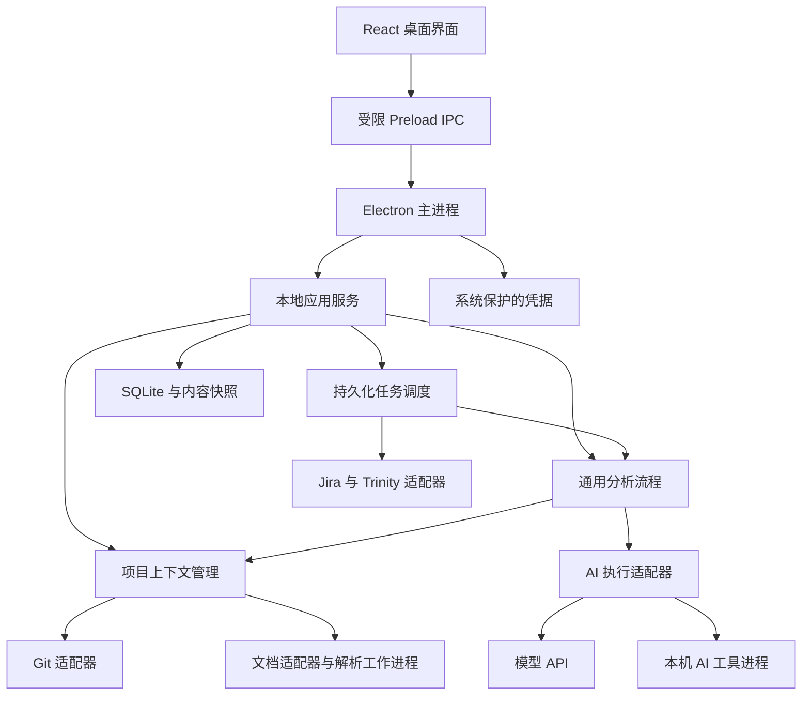

# 本地研发辅助平台技术选型与架构设计

版本：0.2　日期：2026 年 10 月 19 日　状态：技术设计已认可，第二阶段本地能力已实现，外部真实联调待验收

平台运行在开发者电脑上，以项目配置关联独立代码分析目录、需求文档和 BUG 来源，使用可替换的 AI 执行方式完成需求实现核对与 BUG 预分析。本文明确第一版技术选择、模块职责、数据契约、任务流程和验收要求，供后续实施使用。

产品边界及第一、第二阶段实施计划已经确认。首发 Windows x64，业务核心通过接口隔离操作系统能力。工程根目录为 `D:\development\Develop-a-general-purpose-platform`；本文描述完整目标架构，不代表连接器已完成实际环境联调。当前交付与验证边界见 [第二阶段开发验收记录](第二阶段开发验收记录.md)，第一阶段记录保留为历史基线。

## 1 产品目标与范围

### 1.1 已确认的要求

- 第一版供个人使用；人员、项目、代码路径和文档来源均通过配置表达，不写死到业务流程。
- 每台开发电脑独立安装，无需中心服务器。每位开发者只配置自己参与的项目。
- 开发者自行下载代码，为每个项目配置独立分析目录、远程仓库及分支。平台不负责克隆仓库。
- 分析前自动更新对应分支；更新失败时停止该任务，不用旧代码冒充最新结果。
- BUG 首批支持 Jira 和 Trinity。查询必须受已配置项目及任务归属条件约束。
- 文档首批支持本地 Word、PDF 和飞书文档，后续通过适配器增加来源。
- AI 同时支持模型 API 和本机 AI 编码工具。
- 输出需求实现项、缺失项、待确认项，以及 BUG 预分析报告和排查步骤；结论附可定位的依据。

### 1.2 第一版功能边界

包含项目管理、接入诊断、手动需求核对、手动 BUG 分析、自动监控、任务取消与重试、报告历史和 Markdown 导出。

不包含自动修复代码、构建项目、执行仓库脚本、提交代码、修改 BUG 状态、自动发表评论、跨电脑数据同步、团队权限平台及第三方插件市场。适配器首先是随应用发布的模块，不是任意脚本热加载机制。

Word 首批原生支持 `.docx`；旧 `.doc` 需要开发者先转换为 `.docx` 或 PDF。PDF 首批支持文本型文件；扫描件和图片内需求进入解析缺口提示，OCR 和视觉理解保留扩展接口，不算作首版已具备能力。

### 1.3 成功标准

对同一项目，在不修改核心流程的情况下能够更换文档来源、BUG 来源和 AI 执行器。分析结果能够回答：依据哪份需求、哪个代码提交、哪一版问题内容、检查了哪些范围，以及哪些结论尚待验证。

## 2 技术选型

### 2.1 桌面技术路线比较

| 路线 | 对本项目的适配性 | 主要代价 | 决策 |
| --- | --- | --- | --- |
| Electron 与 TypeScript | 桌面界面、Git 子进程、网络连接器和 AI 编排可以共用语言 | 安装包与内存占用较高，需维护 Chromium 安全更新 | 采用 |
| Tauri 与 Web 前端 | 适合重视包体积、愿意维护 Rust 宿主的团队 | 本方案会增加 Rust 与 TypeScript 两套工程边界，或额外引入服务进程 | 保留为替代方案 |
| Python 与 Qt | 文档处理生态便于快速试验 | 桌面体验、依赖打包和跨进程契约仍需单独维护 | 不作为主架构 |

以上比较是针对当前产品范围的工程判断，不是性能基准结论。Tauri 的架构说明见 [Tauri 官方介绍](https://v2.tauri.app/start/)。

### 2.2 推荐技术组合

| 领域 | 选择 | 使用边界 |
| --- | --- | --- |
| 桌面宿主 | Electron | 生命周期、托盘、系统对话框、通知和凭据保护 |
| 界面 | React、TypeScript、Vite | 配置、任务及证据阅读；不直接访问文件系统 |
| 本地应用服务 | TypeScript，运行于 Electron utilityProcess | 任务调度、项目上下文、连接器和分析编排 |
| 协议校验 | Zod，导出版本化 JSON Schema | 校验 IPC、适配器输入输出及模型结果 |
| 结构化存储 | SQLite 与 better-sqlite3，开启 WAL 和外键 | 单一写入进程、事务、任务与配置的唯一权威记录 |
| 检索 | SQLite FTS5、路径索引及受限文本扫描 | 索引是可重建派生数据，不做独立事实来源 |
| Git 操作 | 系统 Git，通过参数数组调用 | 不执行拼接 Shell，不自动安装 Git |
| Windows 进程所有权 | Koffi 与 Windows Job Object | 服务初始化前登记，崩溃后确认全部子进程退出再恢复；首发限定 x64 |
| Word 解析 | Mammoth 解析 `.docx`，转换为内部文档块 | 保留语义结构及解析警告，不追求 Word 排版还原 |
| PDF 解析 | PDF.js，在解析工作进程中运行 | 提取文本、页码与坐标；阅读顺序需质量检查 |
| HTTP | 宿主内置 HTTP 能力，连接器自行适配认证与分页 | 公司代理、证书和错误处理归连接层 |
| 本机 AI 工具 | 固定可执行文件、专用参数映射和 JSONL 事件协议 | 不提供任意命令模板，不假定所有 CLI 都兼容 |
| 测试 | Vitest 与 Playwright | 核心单测、适配器契约、桌面关键流程 |
| 打包 | Electron Forge | Windows 首发，处理原生模块重建与解包 |

选择 TypeScript strict 模式。外部网络响应、磁盘配置和 AI 输出仍需运行时校验，不能依赖编译期类型保证。参考 [TypeScript strict](https://www.typescriptlang.org/tsconfig/strict.html)、[Zod](https://zod.dev/) 和 [Vite](https://vite.dev/guide/)。

SQLite 使用 [WAL](https://www.sqlite.org/wal.html) 配合短事务；不在数据库事务中等待网络或 AI。驱动选择和原生模块发布要求参考 [better-sqlite3](https://github.com/WiseLibs/better-sqlite3)、[Forge 配置](https://www.electronforge.io/config/configuration)及[原生模块解包](https://js.electronforge.io/modules/_electron_forge_plugin_auto_unpack_natives.html)。

实现启动时锁定一组经过打包验证的依赖版本并提交锁文件，不以“永远安装最新版本”作为发布策略。第一版不引入 Python 运行时、Redis、独立搜索服务、向量数据库或微服务。

## 3 总体架构与进程边界



### 3.1 Electron 主进程

只承担窗口、托盘、系统能力、单实例锁、受限 IPC 转发和应用服务生命周期管理，不承担文档解析与长时间分析。

Renderer 显式启用 `contextIsolation` 和 `sandbox`，关闭 `nodeIntegration`。Preload 只暴露具名业务方法，例如添加项目、启动分析和读取报告，不暴露通用文件读取、Shell 或原始 IPC。每条消息校验来源与参数。文档、日志和报告按不可信文本渲染，不执行其 HTML 或脚本。该边界依据 [Electron 安全指南](https://www.electronjs.org/docs/latest/tutorial/security)。

### 3.2 本地应用服务

使用一个长驻 utilityProcess 持有 SQLite 写连接、调度器和业务服务。文档解析以及本机 AI 工具运行在可终止的独立工作进程。通过版本化消息与主进程通信，不开放本地 HTTP 监听端口。

utilityProcess 提供进程隔离及消息通信能力，见 [Electron utilityProcess](https://www.electronjs.org/docs/latest/api/utility-process)。它不是任意本机工具的文件系统安全沙箱；只读执行仍须由工具自身能力或额外隔离保证。

单实例锁防止两个桌面实例同时调度同一数据库。应用服务退出时主进程通知用户并重新启动服务，任务按持久化状态恢复，不伪装为已完成。

### 3.3 模块依赖方向

界面依赖协议；应用用例依赖领域模型和适配器接口；Git、数据库、网络平台和 AI 工具实现这些接口。领域与流程模块不导入 Electron、具体平台 SDK 或 UI 组件。

首版采用模块化单体。各模块在同一产品中发布，通过参数与接口注入连接，不建立分布式服务或第二套业务状态。

## 4 项目配置与隔离

### 4.1 核心配置对象

| 对象 | 关键字段 | 约束 |
| --- | --- | --- |
| Project | id、name、enabled、configRevision | 内部 UUID 为身份，名称可修改 |
| RepositoryBinding | projectId、canonicalPath、remoteName、remoteUrlFingerprint、branch、role | 路径必须是开发者提供的独立分析目录 |
| DocumentBinding | projectId、adapterId、sourceLocator、required、moduleScope | 文档可以是全局或模块级，一项目多文档 |
| IssueBinding | projectId、connectionId、remoteProjectId、issueTypeMapping、ownerPredicate | 必须同时限定远端项目与归属 |
| Connection | adapterId、instanceUrl、deploymentKind、credentialRef | 凭据只保存引用 |
| AIProfile | adapterId、endpointOrExecutable、model、limits、dataEgressPolicy | 配置记录是否可能向外部发送内容 |

项目配置保存时验证本地路径和远端项目映射。解析 Windows 路径大小写、符号链接与目录联接后，禁止同一分析目录重复绑定到相互独立的项目。仓库级锁以规范路径为键，避免别名绕过。

多个仓库均归属于同一项目，快照中分别记录提交。首版要求开发者提供能独立读取的工作树；submodule、Git LFS 对象必须预先就绪。检测到缺失内容时展示具体路径，不把指针文件当作业务源码。

### 4.2 项目与人员的筛选规则

一条问题只有满足“来源连接匹配、远端项目匹配、BUG 类型匹配、归属条件匹配、项目启用”时，才允许生成自动分析任务。规则由同一个 ScopePolicy 表达，连接器将它编译为平台查询条件；返回结果仍调用同一规则做断言，防止查询或字段映射偏差。

不允许用户自定义筛选表达式覆盖项目边界；额外条件只能与项目限制取交集。JQL 的字符串与字段映射由连接器正确转义，用户输入不能直接拼进命令。

平台登录账户只提供访问权限，不代表开发者身份。若共享账户的负责人字段也相同，需要配置可区分的成员字段或标签；缺少这种字段时，该范围只支持人工选择任务，不启用自动归属判断。配置不能阻止他人使用同一外部账户，但可避免本机无范围拉取和跨项目误分析。

同一个远端项目若对应多个内部配置，应要求通过版本、组件等确定性规则唯一映射；无法唯一定位则进入等待处理，不让 AI 猜测代码目录。

## 5 数据模型与本地存储

### 5.1 主要实体

| 实体 | 作用 |
| --- | --- |
| projects 与各类 bindings | 保存项目及资料关联 |
| connections 与 ai_profiles | 保存连接配置和凭据引用 |
| source_snapshots | 保存不可变的文档、问题与附件快照元信息 |
| context_snapshots | 保存一次分析的仓库提交清单、文档版本清单和配置版本 |
| document_blocks 与 search_chunks | 文档结构及可重建检索数据 |
| requirements | 需求条目版本、原文锚点、验收条件及人工修订 |
| issues | 来源连接与远端问题 ID 对应的最新观测状态 |
| issue_observations | 归属变化、内容指纹和观测时间 |
| monitor_cursors | 每条监控规则的同步水位及最近成功时间 |
| tasks 与 task_attempts | 逻辑任务、每次执行、状态、错误和运行租约 |
| reports、findings 与 evidence_refs | 版本化报告、结论和证据引用 |
| task_events | 有序进度、诊断和恢复记录 |

所有项目资料查询携带 projectId；证据和报告校验其上下文归属。通用“列出全部项目”只返回配置摘要，不把不同项目的材料混入同一 AI 上下文。

### 5.2 数据权威性

SQLite 是配置、任务和报告元信息的唯一权威记录。原始文件与规范化快照按内容哈希存放在应用数据目录，数据库保存引用。FTS 索引、界面缓存和导出 Markdown 均是派生结果，不接受反向覆盖权威数据。

内容文件先写临时文件并校验哈希，再原子移动到目标位置，最后提交数据库引用。崩溃产生的无引用文件可后续回收，不能出现数据库指向尚未完成的快照。清理仅处理应用拥有的内容目录，不删除开发者配置的仓库或原始文档。

数据目录由 `app.getPath('userData')` 确定，逻辑结构为数据库、内容快照、索引、日志和导出。采用系统用户访问权限；普通报告与代码快照不宣称自动获得完整磁盘加密保护。

### 5.3 备份与迁移

数据库结构通过递增 migration 管理；升级前使用 SQLite 备份能力生成一致副本，不能运行中只复制 `.db` 而忽略 WAL。备份包含受引用的快照清单；凭据不跟随可移植项目配置导出。跨电脑恢复需要重新绑定目录和登录。

有历史报告引用的内容不自动删除。可重建索引允许清理；原始快照的保留由用户在存储管理中选择，删除后报告明确显示证据已不可读取。

## 6 适配器契约

接口是领域端口，不暴露平台原始响应作为通用流程的直接依赖。

| 接口 | 核心操作 | 输出要求 |
| --- | --- | --- |
| RepositoryAdapter | inspect、synchronize、capture、read、search | 仓库身份、准确提交、受限文件读取 |
| DocumentAdapter | inspect、fetchSnapshot、parse | 原始快照、内部文档块、警告与解析覆盖范围 |
| IssueAdapter | validateScope、poll、getIssue、getHistory、fetchAttachment | 标准问题、可选历史、游标和平台能力 |
| AIExecutor | probe、run、cancel | 能力声明、标准事件、结构化结果 |
| CredentialStore | save、resolve、remove | 按连接及操作限定的凭据，不向 UI 返回明文 |

接口数据带 `schemaVersion`；每个适配器记录实现版本。升级输入或输出时保留明确兼容策略，不在解析失败时用空结果掩盖不兼容。

统一错误字段为 code、stage、message、retryable、requiredAction、diagnosticRef。包括认证失败、无权限、限流、网络失败、输入不支持、解析不完整、工作区脏、分支不符、能力不足、输出无效和取消。

第一版适配器通过静态注册表发布。新增来源需要实现契约、运行契约测试并发布应用版本；后续确有需求时再设计独立插件分发协议。

## 7 代码同步与不可变上下文

### 7.1 更新步骤

1. 获取项目执行锁及规范仓库路径锁；多仓库按稳定顺序加锁。
2. 检查仓库身份、当前分支、远程地址、跟踪关系和进行中的 Git 操作。
3. 检查 staged、unstaged、untracked 内容。发现本地变更或未完成合并、变基时等待人工处理。
4. 对配置的远端和分支执行 fetch，固定本次取得的远程提交 SHA。
5. 判断本地与远程提交关系。落后时仅快进；本地领先或分叉时停止，不自动 reset。
6. 更新完成后确认 HEAD 等于本次获取的远程 SHA，且工作区仍干净。
7. 以该 SHA 建立代码读取清单，收集已跟踪文件的内容哈希。
8. 同步文档并建立上下文快照，之后开始分析。

Git `--ff-only` 在无法快进时拒绝合并，见 [Git merge](https://git-scm.com/docs/git-merge)。但它不足以拒绝“本地已经领先”的情况，因此必须额外检查提交相等。

“最新”准确指本次成功 fetch 时配置远端分支的提交，而非保证远端在分析结束前没有新提交。报告记录获取时间及 SHA。网络失败不能复用上次 fetch 结果继续自动任务。

### 7.2 同步副作用与限制

使用 `spawn` 或 `execFile` 的参数数组及 `shell: false`，验证分支、路径和远端标识。禁止自动 stash、reset、clean、checkout、rebase 或创建合并提交。

Git 更新本身可能涉及本机配置的 hooks、filters 和 LFS。适配器禁用 hooks 及不需要的递归更新；首次接入检查过滤器和特殊检出需求。无法按首版安全配置同步时明确阻塞，不能承诺 Git 更新绝不触发外部程序却放任仓库配置执行。Git 凭据使用已配置的本机凭据机制，日志隐藏敏感远程 URL 和令牌。

### 7.3 快照读取策略

API 分析通过提交 SHA 读取 Git 对象，不用可变工作目录作为证据来源。非 Git 的原始文档先复制成内容快照再解析。

需要真实目录的本机 AI 工具，只获得从同一提交导出的任务材料目录，不读取开发者日常目录或平台凭据。导出时限制文件数量、单文件和总大小，拒绝目录穿越、设备路径及越界符号链接；凭据和排除文件不进入材料目录。

任务材料是只读分析输入，工具只能在单独结果目录写报告。没有可验证的只读模式或可用隔离机制的工具不能用于自动任务，仅把提示词写成“不要修改”不算只读保证。

同一项目首版串行完成准备与分析，防止切换上下文；不同项目可以在资源上限内并行。一次多仓库快照记录各仓库实际提交，不宣称它们是业务上同步发布的一组版本。

多仓库先完成全部预检查，再依次同步。若后一个仓库失败，保留前面已成功的同步并记录结果，不自动回退分支，也不发布不完整的上下文快照；重试时重新检查所有仓库。任务开始后有远程新提交时，当前报告仍对应已固定的版本，界面允许发起新分析，不在任务内部悄悄替换输入。

## 8 文档解析与检索

### 8.1 内部文档表示

所有来源转换成 DocumentBlock：文档快照 ID、块 ID、类型、标题层级、文本、表格行列关系、原文锚点、关联资源及解析警告。文档块与需求条目不同，需求提取后继续引用原文块。

| 来源 | 原文锚点 | 处理边界 |
| --- | --- | --- |
| DOCX | 标题路径、段落或表格序号、原文摘录 | 不生成不可靠的 Word 页码 |
| PDF | 页码、文本范围及可用坐标 | 检测提取为空、乱码与阅读顺序异常 |
| 飞书 | 文档 token、blockId、抓取版本或内容哈希 | 文档授权、分页与关联 Wiki 解析由连接器处理 |

Mammoth 可转换标题、列表和表格，但复杂文档可能丢失呈现细节，见 [Mammoth 文档](https://github.com/mwilliamson/mammoth.js)。转换结果先进入内部结构，不直接作为可信 HTML 展示。PDF.js 用于文本型 PDF 解析，见 [PDF.js](https://mozilla.github.io/pdf.js/)。

飞书优先读取块结构，而不只读取拼接后的纯文本，接口参见[获取文档所有块](https://open.feishu.cn/document/server-docs/docs/docs/docx-v1/document/list)。链接解析区分 Docx、Wiki 和不支持的文档类型，不把任意飞书链接视为同一种 token。

飞书应用权限、文档访问权限和企业应用审批需要分别满足。连接测试读取一份用户明确关联的文档；不能因为平台 token 有效就认定项目文档可读。

### 8.2 完整性与版本

本地文件读取前后核对元信息和内容哈希，变化时重新获取。远端提供版本一致读取能力时使用该能力；否则抓取前后核对版本，最多重取两次，仍持续变化则等待处理。不能把跨分页的混合内容标为同一稳定版本。

必需文档读取失败，依赖它的分析不启动；可选文档失败可以继续，但报告必须列出缺失资料及受影响结论。检测到图片要求、扫描页、未知块或表格损失时，受影响需求标为无法确认，不能据此判定缺失或完成。

### 8.3 检索策略

首版采用路径、关键词及 FTS5 检索，AI 基于已检索证据决定继续读取的范围。搜索和读取始终绑定 projectId 与 contextSnapshotId。

中文长词采用 trigram 子串索引；少于三个字符的词使用显式、限量的文本扫描，并在检索轨迹中记录执行方式。FTS5 trigram 对短字符串的限制见 [SQLite FTS5](https://www.sqlite.org/fts5.html)。关键词检索提供定位线索，不承担完整语义召回保证。

代码按文件及有界行块索引；模块与调用关系由配置文件、符号引用和 AI 读取逐步归纳，并保留出处。首版不宣称建立跨语言精确调用图；反射、生成代码、动态加载和外部服务列入分析限制。语言解析器和向量检索可作为后续检索增强，不替换证据源。

索引键包含内容哈希及解析器版本。更新后只重建变化内容；新快照的检索清单准备完成后原子发布，不能让任务查到混合版本。

## 9 BUG 监控与变化识别

### 9.1 平台连接

Jira 配置显式区分 Cloud 和 Data Center，使用各自 API、身份字段和分页方式。Cloud 搜索采用 enhanced JQL search 及 token 分页，见 [Jira Cloud issue search](https://developer.atlassian.com/cloud/jira/platform/rest/v3/api-group-issue-search/)；Data Center 走独立实现，见 [Jira Data Center search](https://developer.atlassian.com/server/jira/platform/rest/v10003/api-group-search/)。不通过一次失败请求静默猜测部署类型。

Trinity 的目标实例、认证方式、项目字段、负责人字段、分页、历史和附件接口必须通过实际实例的只读资料与响应样本建立映射。本设计不假设它具有 Jira 的字段或路径。Trinity 是首版交付目标，接入测试失败时连接显示不可用，不能发布为已支持。

### 9.2 轮询与归属变化

首次连接进行项目内基线同步，只列出现有匹配问题，由用户选择是否分析存量。首次成功完成所有分页后才启用增量水位。

后续每个连接和项目规则独立轮询。优先利用更新时间和变化历史，设置重叠查询窗口以减少索引延迟导致的漏查；来源不支持可靠增量时，在已配置项目与归属范围内分页核对，明确显示能力限制。不会以全账户无项目限制的扫描代替。

维护已匹配问题集合，并在所属项目范围内复查其最新归属，识别转出。再次转入时记录新的归属周期。目标平台若提供历史，可识别两次轮询之间的转出再转入；否则只能报告已观测的状态变化，不保证捕获中间全部事件。

### 9.3 去重与一致性

问题主键为 connectionId 与 remoteIssueId。跨 Jira 和 Trinity 的相似问题保持独立，关联必须有明确依据，不自动合并。

自动任务事件键包括 bindingId、issueId、归属周期及分析输入指纹。输入指纹覆盖描述、相关评论、附件元信息和关键字段，排除单纯的浏览次数等噪声。

一次分页周期抓取结束后，在短事务中更新问题观测、插入去重任务并推进水位。中途失败不推进水位，重放由唯一约束去重。远端分页 token 只作为该轮查询的临时状态，不等同于持久化同步水位。

自动分析开始前重新验证项目和归属；已经转出的问题不继续自动分析。执行中转出不破坏已保存材料，但报告标记归属已变，停止后续自动重分析。

相同问题执行中再次变化，只保留一个待执行的最新输入任务，当前结果标为旧输入。取消、失败和重试不会绕过去重；显式“重新分析”生成带请求标识的新任务。

### 9.4 持续监控边界

首版监控在桌面应用或托盘进程存活时运行。关闭窗口可进入托盘，明确退出则停止监控。电脑休眠、断网或关机期间不能实时监控；恢复后按水位补查，展示最近成功同步时间及覆盖缺口。

缺少可靠增量接口时定期进行范围内完整核对，默认每日一次。即使有重叠窗口，也不把最终一致性搜索宣传为绝对不漏事件。

## 10 AI 执行与通用分析流程

### 10.1 任务协议

统一 AnalysisRequest 包含 taskId、projectId、contextSnapshotId、issueSnapshotId 或 requirementSetId、目标、协议版本、允许的工具、输出 schema、模型配置和资源预算。

AIExecutor 声明输入模式、结构化输出、流式事件、取消、工具调用、只读执行、外部网络和上下文上限等能力。需求由任务描述，能力由适配器探测并通过契约测试确认，不能由 UI 勾选框替代。

标准事件为 started、progress、evidenceReferenced、usage、completed、failed、cancelled。平台保存阶段和审计轨迹，不采集或要求模型输出内部推理过程。

### 10.2 模型 API

API 模式由平台控制取证工具，模型只可请求读取快照文件、搜索当前项目、读取文档块和查看已下载问题材料。平台执行工具调用并返回有界内容。不存在模型可调用的通用 Shell。

供应商适配器负责 HTTP、流式响应、鉴权、工具调用和结构化输出格式转换；不把某一种“兼容 API”宣称为所有模型的统一协议。不支持原生结构化输出的模型仍需经过同一结果校验，不得返回自由文本后冒充有效报告。

具体模型供应商是连接配置，不影响领域模型。首个供应商和模型在进入实施前，以实际可用账户、数据政策及一组固定样例测试确定，不在当前设计中虚构其已获权限。

### 10.3 本机 AI 编码工具

每种工具使用专用适配器，映射启动参数、身份、输出和取消。Windows 启动后台进程时隐藏窗口；只允许配置可执行文件及受校验的选项，不拼接用户命令字符串。

输入通过 stdin 或仅当前用户可读的任务文件传递，避免凭据和完整提示词暴露在进程命令行。stdout 按 JSONL 读取标准事件，stderr 作为脱敏诊断。输出文件由平台验证后导入，不授予工具直接写数据库的权限。

自动执行必须满足非交互、可取消、结果可解析和只读能力。工具已安装不代表平台可借用它的订阅、账号或自动化权限；实际支持版本、授权和能力探测通过后才显示为可用。

API 和 CLI 不自动互相切换。失败时保持原任务状态，避免未提示就换服务商、数据传输边界或费用来源。

### 10.4 需求核对

文档提取需求候选，关联原文及验收条件；无法形成可检验条件的条目标记待澄清。开发者可修订提取结果，修订形成新版本并保留来源。

对每个需求依次定位相关模块、读取实现与分支条件、检查明确的反例或未覆盖路径，输出已实现、部分实现、缺失、无法确认或需求冲突。

已实现必须有支持需求条件的正向证据；缺失必须附检查范围和明确的未覆盖依据。仅仅搜索不到名称不足以判定缺失。涉及运行行为但没有运行验证时，单独标记“静态分析，未运行验证”。

### 10.5 BUG 预分析

输入包括问题快照、项目快照、相关需求、可读取附件及版本信息。提取复现条件后检索相关代码，给出候选调用路径、可能原因、支持与反对证据、排查步骤以及缺少的信息。

报告区分代码中已确认事实与原因假设。配置分支最新代码与问题发生版本不同时，展示版本差异；不得将当前分支中不存在问题直接解释为历史问题无效。首版不自动猜测或切换历史分支。

文本日志作为首批附件解析对象；截图、视频、压缩包和转储文件按能力显示未解析清单。原始附件只从已配置平台或其已验证的下载域获取，限制大小与重定向；不会自动抓取描述中的任意 URL。

### 10.6 结果校验

完成前校验结构、枚举、必填字段和证据归属。代码证据必须包含仓库、提交、路径、行范围及片段哈希；文档证据包含快照和原文锚点。引用不存在、越界或跨项目时，结果不通过。

可对结构错误进行一次带错误信息的修正请求，仍失败则记录 OUTPUT_INVALID。引文真实性校验不等同于结论语义正确，语义质量通过人工复核与基准样例检验。

历史报告保持不可变。人工反馈作为关联记录保存；输入、配置、提示模板、解析器或执行器变化时，重新分析生成新版本，不覆盖旧报告。

报告协议统一包含 reportId、schemaVersion、projectId、taskId、attemptId、contextSnapshotId、inputSnapshotIds、executorVersion、templateVersion、createdAt、findings、evidenceRefs、limitations 和未解析材料清单。每条结论包含类型、依据、检查范围及验证状态；BUG 假设另附下一步排查动作，需求结果另附 requirementId。模型未返回可靠用量时 usage 明确为空，不能填零表示没有费用。

## 11 调度与状态机

### 11.1 状态定义

| 状态 | 含义与后续行为 |
| --- | --- |
| QUEUED | 等待资源与项目锁 |
| PREPARING | 验证归属、更新代码、同步文档、固定快照 |
| RUNNING | 执行 AI 与受限取证 |
| VALIDATING | 校验结果结构与证据 |
| SUCCEEDED | 报告与成功状态已原子提交 |
| WAITING_INPUT | 工作区、权限、映射或材料需要人工处理 |
| RETRY_WAIT | 暂时错误，等待有上限的退避重试 |
| INTERRUPTED | 异常退出或中断，需要恢复判定 |
| FAILED | 本次尝试失败且不再自动重试 |
| CANCELLING 与 CANCELLED | 已请求停止，以及进程结束后确认停止 |

主路径是 QUEUED → PREPARING → RUNNING → VALIDATING → SUCCEEDED。恢复产生新的 attempt，并重新准备和同步代码，不接续一段上下文已不确定的模型会话。任务历史保留所有尝试及其输入。

### 11.2 调度规则

首版默认全局一个 AI 任务、每项目一个活动任务，允许配置全局上限为两个；同目录无论属于哪条任务都受同一个锁控制。网络轮询使用独立小并发，不占用 AI 执行槽。

取消先通过 AbortSignal 或工具协议停止，再在宽限期后终止本任务的进程树。Windows 需要可验证的进程树回收实现；无法确认子进程结束时不报告已取消，也不释放其占用的执行资源去启动冲突任务。

任务在数据库事务中认领并记录 attempt、lease 和心跳。服务重启后检查所有非终态尝试，标记中断、清理已确认退出的子进程，再恢复排队。报告保存和 SUCCEEDED 状态在同一事务提交，避免“报告存在但任务重跑”产生多份成功结果。

### 11.3 建议初始参数

以下为可配置起点，不是性能承诺：

| 参数 | 初始值 |
| --- | --- |
| BUG 轮询 | 每条规则 5 分钟，加入轻微随机偏移 |
| 增量重叠窗口 | 10 分钟，按平台查询语义校准 |
| 范围内完整核对 | 每日一次，应用恢复时补执行到期任务 |
| 普通网络请求 | 30 秒，附件另设总量和时间限制 |
| Git 同步 | 5 分钟，超时后明确失败并检查残留进程 |
| 单次 AI 分析 | 20 分钟，另有限制调用次数与 token 预算 |
| 暂时错误重试 | 最多 3 次，指数退避并遵守 Retry-After |
| 项目内任务 | 串行 |

认证或权限错误不自动无限重试，连接进入需要处理状态。限流退避不推进监控水位。用户能看到尝试次数和下次执行时间。

## 12 桌面信息架构

| 页面 | 主要内容 | 必须可见的信息 |
| --- | --- | --- |
| 总览 | 启用项目、新问题、活动任务、异常 | 最近监控成功时间和失效连接 |
| 项目管理 | 代码、分支、文档、BUG 映射、AI 配置 | 连接测试及代码同步检查结果 |
| 需求核对 | 文档版本、需求清单、实现状态、证据 | 无法确认与解析缺口 |
| BUG 工作台 | 范围内问题、分析报告、历史 | 归属、问题版本与代码版本差异 |
| 任务详情 | 阶段、日志、取消、重试 | 失败原因和需要用户采取的动作 |
| 设置 | 连接、凭据、AI、调度、存储 | 数据外发边界和资源限制 |

首次接入引导按“本地路径和分支 → 文档 → BUG 项目与归属 → AI → 接入检查”进行。监控可单独开关，未启用监控仍可手动分析。

报告详情展示结论与相邻证据；点击代码查看固定提交内容，而非跳到已经变化的工作树。外部 BUG 和飞书链接通过经验证的地址打开系统浏览器。任务进度使用真实阶段和计数，不伪造 AI 完成百分比。

## 13 安全与资料边界

凭据由主进程通过 CredentialStore 访问。Windows 首版使用 Electron safeStorage 加密后保存，解密值仅进入需要它的连接器调用；Renderer、日志、报告和导出均不含明文。其 Windows 保护基于 DPAPI，但不是防御同一用户下恶意进程的边界，见 [Electron safeStorage](https://www.electronjs.org/docs/latest/api/safe-storage)。移植 Linux 时必须检查可用的系统后端，不接受明文回退。

代码、需求、问题描述、附件及仓库中的说明文件都作为数据。其内容不能增加工具权限、改变平台配置或要求读取其他项目和凭据。平台自身的提示模板与策略来自应用发布包。

项目材料访问由统一 ContextAccessPolicy 控制：同时约束项目、快照、文件范围和数据外发规则。索引、搜索、直接读取及 CLI 材料导出共用这项策略，避免排除的文件仍能通过另一条路径被 AI 读取。默认排除私钥、凭据文件、平台自身数据和项目配置指定的敏感路径；规则是有界保护，不承诺识别源码中所有隐含秘密。结果中记录因排除而无法检查的范围。

项目设置明确哪些资料可以发送给外部模型。服务地址或执行器变更后重新校验数据传输策略。自动监控只使用已经完成配置的 AIProfile，不在任务中临时选择新供应商。

任务材料目录与系统目录进行真实路径检查，防止符号链接或路径穿越；文件读取有类型与大小上限。网络使用可信证书验证，允许配置企业 CA 和代理，不提供“忽略全部证书错误”的开关。下载目标和重定向按连接器配置校验，且跨域不转发原平台认证头。

日志默认仅保存元信息、诊断码和截断脱敏文本。完整提示上下文不作为默认日志；报告证据属于项目数据，应随项目存储管理。发布前审查依赖许可证及安全更新策略。

## 14 工程模块与发布

建议使用一个 TypeScript workspace，并保持少量清晰模块：

```text
apps/desktop/          Electron 宿主、preload、React 界面
packages/contracts/   IPC 与适配器协议、schema
packages/core/        项目领域、用例、调度及分析流程
packages/adapters/    Git、文档、Jira、Trinity、AI 的具体实现
packages/storage/     SQLite、migration、内容快照
packages/testkit/     脱敏样例和契约测试工具
```

这是架构目录草案，不要求每个类独立发布 npm 包。核心业务模块可以脱离 Electron 进行测试。

Windows 首版发布安装包；运行时无需额外安装 Node.js 或 Python。系统 Git 及选用的本机 AI 工具由开发者安装，接入诊断检测其版本与可执行状态。better-sqlite3 的原生模块必须按目标 Electron ABI 构建并验证安装包加载。

第一版使用手动安装升级，暂不建设自动更新服务器。升级时保留本地数据，执行迁移和备份；开发版与正式版使用不同应用数据目录。跨平台支持通过独立打包与系统能力验收后再宣称可用。

## 15 实施阶段与验收

以下阶段用于划分实施边界，不是工期承诺。详细任务拆分在技术设计评审后编写。

| 阶段 | 可交付能力 | 退出条件 |
| --- | --- | --- |
| 1 本地基础 | 桌面框架、项目配置、存储、Git 检查和同步 | 能阻止脏目录、分支错误与本地领先，并记录提交 |
| 2 需求闭环 | DOCX、文本 PDF、飞书；需求提取与手动核对；一个 API 实现 | 固定样例可追溯到原文和代码，解析损失可见 |
| 3 问题闭环 | Jira、Trinity 只读接入，项目与归属映射，手动 BUG 分析 | 两种平台均完成目标实例契约测试及一条真实问题分析 |
| 4 自动监控 | 基线、增量、转入转出、队列、重启恢复 | 重复轮询、分页失败及重启不会产生重复成功报告 |
| 5 执行扩展与发布 | 一个本机 AI 工具实现、只读校验、取消、安装包 | API 与 CLI 用同一验收样例输出可校验报告 |

完整第一版包含上述五阶段，不把中间里程碑当作全部功能交付。

### 15.1 自动化验证

- 核心单测：范围规则、归属周期、任务去重、状态转换、输入指纹、版本清单和证据校验。
- Git 集成测试：使用临时本地仓库模拟落后、相同、领先、分叉、脏工作区和远端消失，确认没有隐式丢弃变更。
- 文档契约测试：中文标题、复杂表格、脚注、扫描 PDF、乱码、飞书分页和抓取时内容变化。
- 平台契约测试：Cloud 与 Data Center 分开验证；Trinity 使用目标实例脱敏样例。检查项目约束、共享账户、转入转出、分页、权限和限流。
- 调度故障测试：在推进水位、导入快照、提交报告的边界强制退出，验证恢复及幂等。
- AI 契约测试：无效 JSON、伪造引用、越界路径、超时、能力不足和取消后子进程退出。
- 桌面 smoke test：安装启动 → 创建 A/B 项目 → 同步 → 手动分析 → 开启监控 → 查看报告 → 重启恢复。

常规后端单测单例设置 60 秒超时。验证顺序为目标单测、类型检查与 lint、受影响包构建、最小桌面 smoke test。

### 15.2 分析质量验收

建立人工标注的首批样例：建议至少 20 条需求和 10 个已定位根因的 BUG，覆盖完整实现、部分实现、明确缺失、文档冲突、材料不足和问题版本不匹配。

发布硬条件：证据定位校验全部通过；A/B 项目材料不串用；样例中不允许出现“材料缺失却断言已实现或已确定根因”的严重误判。统计需求分类一致性、BUG 候选原因的证据充分性及排查步骤可执行性，分别展示，不用一个模型自评分替代评估。

性能基线记录仓库文件量、文档规模、首次与增量准备耗时、峰值内存、AI 用量及最终报告时间。使用固定硬件和相同快照对比；模型响应时间不与本地检索时间混成一个不可解释指标。

## 16 实施接入条件与设计决策

### 16.1 进入连接器开发前应取得的输入

这些是实际接入条件，未取得时相应连接器不能启用，但不影响本地核心模块开发：

| 输入 | 获取与验证方式 |
| --- | --- |
| Jira 实例和部署类型 | 确认 Cloud 或 Data Center、认证、项目和人员字段 |
| Trinity 实例契约 | 只读 API 资料及脱敏响应，验证项目、归属、分页与附件 |
| 飞书访问方式 | 验证目标文档、应用权限、访问主体及企业审批 |
| 首个模型 API | 选定可用供应商及模型，执行能力和数据政策检查 |
| 首个本机 AI 工具 | 指定工具与版本，验证非交互、只读、取消及结构化输出 |
| 代表性项目 | 独立代码目录、配置分支、需求集合和历史 BUG 样例 |

### 16.2 决策记录

| 决策 | 原因 | 扩展条件 |
| --- | --- | --- |
| 本地模块化单体 | 匹配个人电脑运行，减少部署依赖 | 出现实际跨电脑协作需求再设计同步 |
| Electron 与 TypeScript | 共用界面、连接器及流程开发语言 | 若资源基线不可接受，再评估替代宿主 |
| SQLite 与内容快照 | 单用户场景可事务恢复并追溯输入 | 检索或存储实测不足再引入专门组件 |
| 开发者下载独立目录 | 保持代码来源透明，避免干扰开发目录 | 不自动演变成仓库托管功能 |
| 同步后固定 SHA | 避免过期和混合版本分析 | 后续显式支持历史版本选择 |
| API 与 CLI 共用结果协议 | 避免维护两套分析业务 | 新执行器必须通过同一契约测试 |
| 确定性流程加 AI 理解 | 程序保障边界、AI 处理语义 | 不让模型接管权限与归属决策 |
| 首版静态注册适配器 | 满足扩展并控制维护复杂度 | 真有独立分发需求再引入插件运行时 |

本设计的下一份交付物是分阶段实施计划。计划应明确可执行任务、文件边界、测试和验收顺序；在设计评审通过后编写，不在本文中提前开始产品实现。
